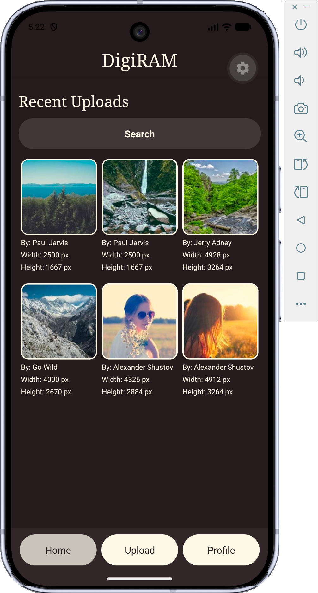
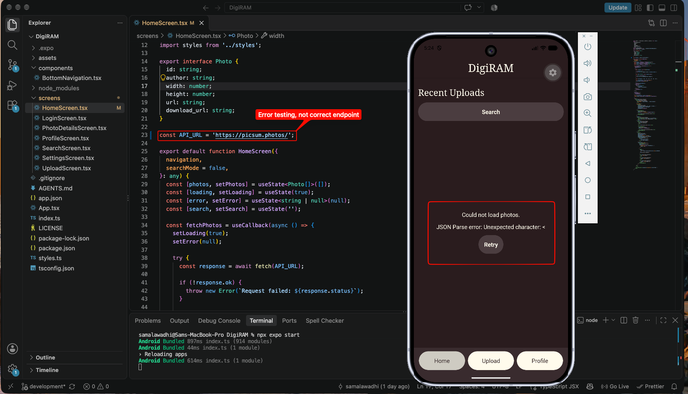

## Setup Instructions

1. Install Node.js and Android Studio
2. Start the app with `npx expo start` in the terminal and press `a` to open Android.
3. Enter a username (anything works, credentials are still WIP) and continue to Home.

## Testing
4. Confirm photos and their API information appear.
5. Temporarily replace API_URL in screens/HomeScreen.tsx with https://picsum.photos/ (or anything that won't point to an actual API)
6. Save the changes and reload the app by pressing `r` in the terminal.
7. Confirm an error message and Retry button appear.
8. Restore the original endpoint, save, and reload.
9. Confirm photos load again.

## Screenshots

Successful response:
 

Error state:
 
